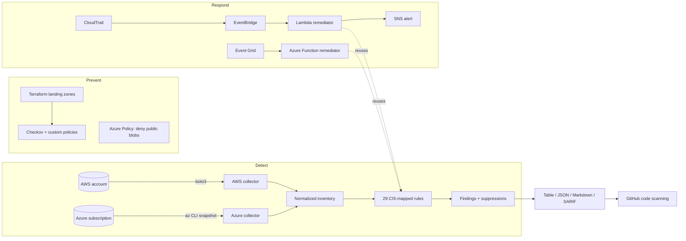

# Palisade

**Multi-cloud security posture management for AWS and Azure: detect misconfigurations, fix them automatically, and prove it with attack simulation.**

[](https://github.com/PrimelPJ/palisade/actions/workflows/ci.yml)


Palisade covers the full loop a cloud security engineer owns:

| Stage | What Palisade does | Where |
|---|---|---|
| **Prevent** | Hardened landing zones in Terraform, custom Checkov policies and an Azure Policy deny rule that block insecure config before it ships | `terraform/`, `policies/` |
| **Detect** | 29 rules mapped to the CIS AWS and CIS Azure benchmarks, run against live accounts, read-only snapshots, or CI | `src/palisade/rules/` |
| **Respond** | Event-driven remediation: a risky API call triggers a scoped rescan and an automatic fix within seconds | `functions/` |
| **Prove** | Attack simulation emulating six MITRE ATT&CK cloud techniques, with a generated report | `src/palisade/simulate.py` |

Everything runs locally with no cloud account: AWS is emulated with [moto](https://github.com/getmoto/moto), and Azure is scanned from `az` CLI snapshots.

---

## Architecture



The key design choice is that **collection and evaluation are separate**. Collectors turn each cloud into a plain-data inventory; rules are pure functions over that inventory. The same rules therefore run in the CLI, in CI, inside the Lambda, and inside the Azure Function, and every rule is unit-testable without a cloud account. See [docs/architecture.md](docs/architecture.md) for the design decisions.

---

## Quickstart (no cloud account needed)

```bash
git clone https://github.com/PrimelPJ/palisade.git && cd palisade
python -m venv .venv && source .venv/bin/activate
pip install -e ".[dev]"

palisade rules                         # list all 29 rules
palisade simulate                      # attack a mocked AWS account, then detect and fix
make demo-azure                        # scan the example Azure snapshot and plan fixes
pytest                                 # 59 tests
```

### Attack simulation results

`palisade simulate` builds a hardened baseline (the same posture `terraform/aws` deploys), runs six attacks, scans, auto-remediates, and rescans. Full output: [docs/attack-simulation-report.md](docs/attack-simulation-report.md).

| Scenario | MITRE ATT&CK | Detected by | Outcome |
|---|---|---|---|
| Make the app data bucket public | T1530 | AWS-S3-001, AWS-S3-004 | Auto-remediated |
| Open SSH to 0.0.0.0/0 | T1562.007 | AWS-EC2-001 | Auto-remediated |
| Stop CloudTrail, disable log validation | T1562.008 | AWS-CT-001, AWS-CT-002 | Auto-remediated |
| Create a backdoor admin user | T1136.003 | AWS-IAM-002, AWS-IAM-004 | Detected, queued for human |
| Disable key rotation and EBS encryption | T1562 | AWS-KMS-001, AWS-EC2-003 | Auto-remediated |
| Weaken the password policy | T1556 | AWS-IAM-006 | Auto-remediated |

**6/6 detected, 11 findings reduced to 2**, and the 2 left open are deliberate (see below).

### Auto-fix vs. human approval

Palisade only auto-applies fixes that **tighten a setting and cannot destroy data or lock anyone out**: enabling Block Public Access, revoking an open SSH rule, restarting a stopped trail. Identity changes are never automatic. An attacker-created admin user is an incident, not a misconfiguration: deleting it would destroy evidence, and detaching a policy from a legitimate user can take down production. Those findings are raised as high severity with the exact remediation command, and the Lambda's IAM policy includes an explicit `Deny` on `iam:Create*`, `iam:Delete*`, `iam:Attach*` and friends, so even a bug in the code cannot make it loosen anything.

---

## Usage

```bash
# AWS: uses your normal credential chain (profile, SSO, env vars)
palisade scan aws --profile prod --region ca-central-1 --region us-east-1
palisade scan aws --format sarif -o palisade.sarif --fail-on high    # CI gate
palisade remediate aws                    # dry run: shows every planned fix
palisade remediate aws --apply            # applies auto-safe fixes only

# Azure: capture a read-only snapshot (needs only the Reader role), then scan it
./scripts/export_azure_snapshot.sh <subscription-id> > snapshot.json
palisade scan azure --snapshot snapshot.json
palisade remediate azure --snapshot snapshot.json     # exact az CLI commands to run

# Save an inventory as audit evidence and replay it later
palisade scan aws --save-inventory evidence/2026-10-01.json
palisade scan aws --inventory evidence/2026-10-01.json --format markdown
```

### Risk acceptance (suppressions)

Real teams accept some risks. Palisade makes that explicit and auditable: every suppression needs a written reason and should carry an expiry, after which the finding comes back automatically.

```yaml
# .palisade-ignore.yaml
suppressions:
  - rule: AWS-EC2-001
    resource: sg-0abc123*
    reason: Legacy bastion; replacement with SSM Session Manager tracked in SEC-142
    expires: 2026-12-31
```

Suppressed findings still appear in JSON and SARIF output (as SARIF `suppressions`), so auditors can see what was accepted and why.

---

## Rules

| Rule | Severity | CIS | Check | Fix |
|---|---|---|---|---|
| AWS-S3-001 | high | 2.1.4 | Block Public Access not fully enabled (bucket or account level) | auto |
| AWS-S3-002 | medium | 2.1.1 | Bucket policy does not deny non-TLS requests | auto |
| AWS-S3-003 | low | 2.1.3 | Versioning disabled | auto |
| AWS-S3-004 | critical | 2.1.4 | Bucket publicly readable or writable via policy or ACL | auto |
| AWS-IAM-001 | critical | 1.5 | Root account without MFA | manual |
| AWS-IAM-002 | high | 1.10 | Console user without MFA | manual |
| AWS-IAM-003 | medium | 1.14 | Access key older than 90 days | manual |
| AWS-IAM-004 | high | 1.16 | User with AdministratorAccess or `*:*` | manual |
| AWS-IAM-005 | high | 1.16 | Role with AdministratorAccess or `*:*` | manual |
| AWS-IAM-006 | medium | 1.8 | Weak or missing password policy | auto |
| AWS-EC2-001 | high | 5.2 | SSH/RDP open to 0.0.0.0/0 or ::/0 | auto |
| AWS-EC2-002 | medium | 5.4 | Default security group allows traffic | auto |
| AWS-EC2-003 | medium | 2.2.1 | EBS encryption by default disabled | auto |
| AWS-CT-001 | high | 3.1 | No multi-region trail logging | auto |
| AWS-CT-002 | medium | 3.2 | Log file validation disabled | auto |
| AWS-CT-003 | medium | 3.5 | Trail not encrypted with KMS | manual |
| AWS-KMS-001 | medium | 3.6 | Customer-managed key rotation disabled | auto |
| AZ-STG-001 | high | 3.7 | Anonymous blob access allowed | function |
| AZ-STG-002 | high | 3.1 | HTTP (non-TLS) allowed | function |
| AZ-STG-003 | medium | 3.15 | Minimum TLS below 1.2 | function |
| AZ-STG-004 | medium | 3.8 | Open to all networks | manual |
| AZ-NSG-001 | high | 6.1 | SSH/RDP open to the internet (ports, ranges, wildcards) | function |
| AZ-KV-001 | medium | 8.5 | Purge protection disabled | manual |
| AZ-KV-002 | low | 8.7 | Public network access enabled | manual |
| AZ-KV-003 | low | 8.6 | Access policies instead of RBAC | manual |
| AZ-IAM-001 | high | 1.23 | Service principal is Owner at subscription scope | manual |
| AZ-SQL-001 | critical | 4.1.2 | SQL firewall allows 0.0.0.0 to 255.255.255.255 | manual |
| AZ-MON-001 | medium | 5.1.1 | Activity log not exported | manual |
| AZ-DEF-001 | medium | 2.1 | Defender for Cloud plans on Free tier | manual |

`auto` = applied by the CLI and the Lambda. `function` = applied live by the Azure Function; the CLI prints the `az` command. `manual` = exact command emitted for a human to review.

---

## Infrastructure as code

### `terraform/aws`: hardened landing zone

- Account guardrails: S3 account-level Block Public Access, EBS encryption by default, CIS password policy, GuardDuty (with S3 protection), IAM Access Analyzer
- Audit logging: multi-region CloudTrail with log file validation, SSE-KMS with a rotating customer-managed key, a log bucket that is versioned, TLS-only, lifecycle-managed and locked to CloudTrail and VPC flow log writers via `aws:SourceArn` conditions
- Network: VPC with flow logs, default security group stripped of all rules, HTTPS-only web tier (admin access via SSM, never SSH)
- Response: the remediator Lambda (X-Ray tracing, DLQ, KMS-encrypted env and logs, reserved concurrency), EventBridge rules for risky API calls, and **cross-region forwarding of IAM events from us-east-1**, because IAM is a global service whose CloudTrail events are only delivered there

### `terraform/azure`: hardened landing zone

- Governance: CIS Azure v2.0.0 policy initiative (audit), a custom **deny** policy for public blob access (prevention, not just detection), required `owner` tag policy, subscription activity log exported to Log Analytics, Defender for Cloud plans (toggle)
- Data plane: storage and Key Vault with public network access disabled, private endpoints, TLS 1.2, Entra ID auth only (shared keys off), purge protection, RBAC authorization
- Response: Python Azure Function with a **user-assigned identity and a custom role** limited to exactly the actions its fixes need, triggered by Event Grid on resource writes

### Policy as code

`policies/checkov/` holds custom Checkov policies that mirror the runtime rules (the same control enforced before deploy and after), plus org-specific ones like required tags and no `force_destroy` on buckets. `tests/test_policies.py` proves each policy rejects a deliberately insecure fixture and that both landing zones pass every check. Every Checkov skip in the Terraform carries a written justification.

### CI pipeline

Every push runs: ruff lint and format, 59 tests on Python 3.11 and 3.12, the attack simulation (posted to the job summary), `terraform fmt`/`validate` for both stacks, Checkov with custom policies, and a Palisade scan whose SARIF lands in the repo's **Security > Code scanning** tab.

---

## Deploying for real

> Both stacks default to **dry-run remediation**, so the first deploy only reports what it would fix. Flip `remediation_dry_run = false` once you trust it.

**AWS** (free tier covers most of this; GuardDuty has a 30-day trial)

```bash
make package-lambda
cd terraform/aws
cp terraform.tfvars.example terraform.tfvars   # set owner, alert_email
terraform init && terraform plan && terraform apply
```

**Azure** (Azure for Students credit covers it; Defender plans are off by default because they bill)

```bash
cd terraform/azure
cp terraform.tfvars.example terraform.tfvars   # set subscription_id, owner, email
terraform init && terraform apply
make publish-azure-function FUNC_APP=$(terraform output -raw remediation_function)
terraform apply -var enable_event_subscription=true
```

---

## Repository layout

```
src/palisade/
  collectors/      aws.py (boto3), azure.py (az CLI snapshots)
  rules/           aws.py, azure.py: CIS-mapped checks
  remediate/       auto-safe fixes (AWS) and az CLI plans (Azure)
  scanner.py       rule engine + suppressions
  report.py        table, JSON, Markdown, SARIF
  simulate.py      MITRE ATT&CK attack scenarios
functions/         aws_lambda/, azure_function/: event-driven remediators
terraform/         aws/, azure/: hardened landing zones
policies/checkov/  custom IaC policies
tests/             59 tests: rules, remediation, functions, policies, CLI
```

## Roadmap

- OPA/Rego policies evaluated with conftest against `terraform plan` JSON
- GCP collector and CIS GCP rules
- Kubernetes (EKS/AKS) posture checks
- Mapping findings to NIST CSF 2.0 and SOC 2 controls for compliance reporting

## License

MIT
